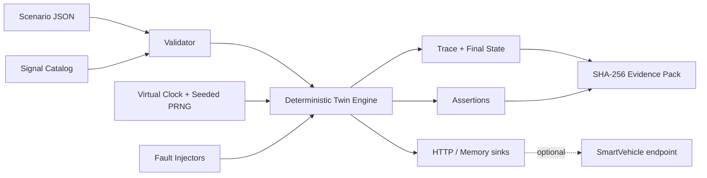

# VehicleTwin Lab

A deterministic vehicle digital twin and fault-injection laboratory for advanced automotive software validation. It simulates typed vehicle signals on a virtual clock, injects reproducible failures, evaluates engineering assertions, captures traces, and produces integrity-protected evidence.

> All values are simulation data. Physical actuation is not implemented. This supports engineering validation; it does not provide certification.

## Implemented capabilities

- OEM-neutral, VSS-mappable typed signal catalogue with units and ranges
- deterministic virtual clock and seeded pseudo-random noise
- time-indexed scenarios and repeatable trace replay
- drop, freeze, offset, noise, invalid, stale, edge-triggered ECU restart, and network-latency faults
- value, validity, and freshness assertions
- trace timeline, statistics, final state, and SHA-256 evidence integrity
- bounded REST API with optional bearer-token access
- HTTP signal sink for SmartVehicle or another isolated endpoint
- responsive browser engineering console
- **32 dependency-free runtime tests**

## Quick start

Requires Node.js 20 or later.

```bash
npm test
npm run demo
npm start
```

Open <http://127.0.0.1:8080>.

For API protection, provide `API_TOKEN` from a secret manager and send it as a Bearer token. Never commit it.

## API

| Method | Path | Purpose |
|---|---|---|
| GET | `/api/health` | Runtime health and version |
| GET | `/api/catalog` | Signal definitions |
| GET | `/api/scenarios/example` | Runnable example |
| POST | `/api/runs` | Validate and run a scenario |
| GET | `/api/runs/{id}` | Full trace and results |
| GET | `/api/runs/{id}/evidence` | Integrity-protected evidence |
| POST | `/api/evidence/verify` | Detect evidence tampering |

Bodies are limited to **1,000,000 bytes**, virtual duration to **3,600,000 ms**, and scenarios to **10,000 events**. The in-memory API retains at most **100 runs**.

## Architecture



The domain engine has no network, UI, database, or vehicle-hardware dependency. Adapters can change without changing scenario semantics. See [architecture contracts](docs/architecture.md) and the [threat model](docs/threat-model.md).

## Scenario example

```json
{
  "name": "example",
  "seed": 42,
  "durationMs": 5000,
  "tickMs": 500,
  "initialState": {"Vehicle.Speed": 0},
  "events": [{"id":"accelerate","atMs":500,"signal":"Vehicle.Speed","value":45}],
  "faults": [{"id":"speed-drop","type":"drop","signal":"Vehicle.Speed","atMs":2000,"durationMs":500}],
  "assertions": [{"id":"bounded","signal":"Vehicle.Speed","operator":"lte","expected":60}]
}
```

## Honest roadmap

SmartVehicle-native composition, SocketCAN/vcan, PCAP import, VSS import, OpenSCENARIO mapping, distributed simulation, durable storage, digitally signed evidence, HIL execution, OIDC, and tenant isolation are not yet implemented.

## Security, safety, and licensing

The server binds to loopback, emits restrictive browser headers, bounds resources, validates signal types/ranges, and supports bearer authentication. Keep it isolated from physical actuator networks unless separately safety-reviewed. See [SECURITY.md](SECURITY.md).

This version is proprietary and source-available. Production, commercial, customer, vehicle, embedded-system, or field use requires a separate written agreement. See [LICENSE](LICENSE) or contact `nagaraj.rbhagwat@expleogroup.com` or an authorized Expleo Group representative. Earlier versions validly released under prior terms retain those grants.
